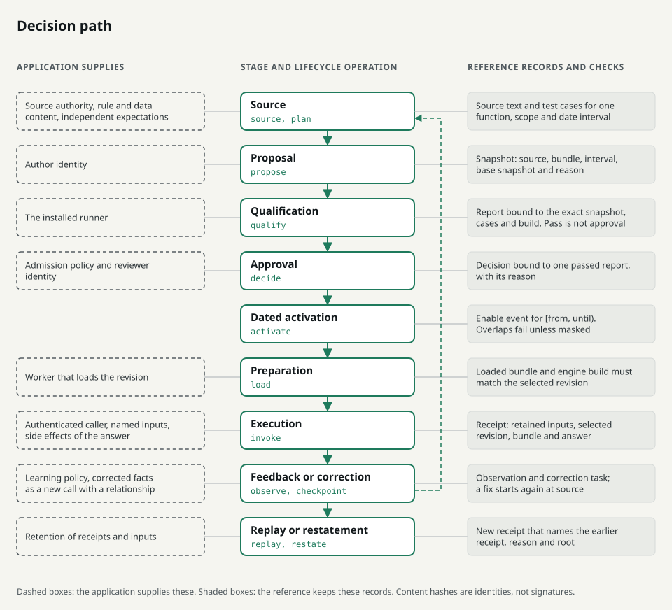

<p align="center">
  <picture>
    <source media="(prefers-color-scheme: dark)" srcset="docs/brand/entelos-logo-dark.svg">
    
  </picture>
</p>

# Entelos

Entelos is an approval workflow for versioned content. An author proposes a change. The application qualifies the exact content. A reviewer approves it. An activation makes it effective on a date. Each version keeps its proposal, checks and approval. Rule hosting is one use: each answer has a receipt with its exact rule version and inputs. Replay uses that earlier version. A correction adds a new record and preserves the earlier answer.

> **Limits:** This is local reference code. [STABILITY.md](docs/STABILITY.md) names the stable APIs and records. It is not a hosted service, an authentication boundary or a production database. Content support is experimental. The application supplies content checks and storage. See [Limits](#limits) and [SUPPORT.md](docs/SUPPORT.md).

## Run a content update

Use Go 1.27.2 or later and Git. Get the code:

```sh
git clone https://github.com/mohanraj00/entelos.git
cd entelos
```

Run the synthetic product FAQ update from the repository root:

```sh
go -C examples/content-update run .
```

The example embeds the real Go Host with an application qualification runner and an in-memory store. It needs no network or CEL build. It prints these steps:

1. Propose an `entelos.content/1` manifest with two FAQ items.
2. Qualify a folder with a changed item. Its digest differs, so qualification fails and the Host refuses approval.
3. Qualify the correct files against the reviewer plan and manifest. Each digest and size agrees. Read the failed report from the Host to check that the store still has it.
4. A separate reviewer accepts the qualified manifest.
5. Activate it from 2026-11-01 until 2026-12-01. The interval excludes the end date.
6. Read the active candidate at 2026-11-15. Check each file against the manifest digest and size before you show its FAQ text.

The reviewer installs the plan cases from [expected.json](examples/content-update/expected.json). This file gives each expected item identifier, digest and size. It simulates a plan that the reviewer owns. In a real deployment, the plan must come from a source outside the candidate.

[content-update/README.md](examples/content-update/README.md) explains the files and limits. [CONTENT.md](src/protocol/content/CONTENT.md) specifies the manifest and dated reads. The [policy verdict spec](src/protocol/policy/POLICY.md) adds accept, refuse or route to a person. The Go Host writes it with the Host-only write `policy_decide`.

## Run a rule update

The rule demo uses [CEL](https://cel.dev) and a local Git history. It runs one invented rule through an answer, a rule change, a replay and a restatement. One run on a Mac took about 1.5 minutes.

| Tool | Version | Check | Install |
|---|---|---|---|
| Go | 1.27.2 or later | `go version` | [go.dev/dl](https://go.dev/dl/) |
| Python | 3 (tested with 3.14.6) | `python3 --version` | [python.org/downloads](https://www.python.org/downloads/) |
| Git | tested with 2.54.0 | `git --version` | [git-scm.com/downloads](https://git-scm.com/downloads) |

This demo needs network access. It downloads the pinned Go modules on each run. macOS and Linux are tested. Windows is not tested. The demo checks Go and Git before the build. It does not check the Git or Python version.

Use a new work directory outside this checkout. The directory must not exist:

```sh
export TASK_WORK="$(mktemp -d)/run"
python3 -B examples/quickstart/demo.py --work "$TASK_WORK"
```

- **Answer:** on 2026-11-15, a `reviewed` record that is not archived is visible. The answer is `true`. A receipt keeps its rule version and input.
- **Rule change:** a new version changes the fixed value from `reviewed` to `approved`. The old version and receipt stay.
- **Replay:** the old receipt still gives `true` on its old rule version.
- **Restatement:** the same input and date under the new rule gives `false`. This is a new answer with its own receipt.

The expected values come from a fixture file. `Result: passed` means that the answers agree with that fixture. [quickstart/README.md](examples/quickstart/README.md) explains the output and failure records. [CORRECTION.md](docs/CORRECTION.md) explains a rule restatement and a fact correction.

## Call a rule from your service

A service calls a rule through the Go lifecycle host [cmd/lifecycle-core](src/lifecycle-core/cmd/lifecycle-core/main.go). Build it with `go build -o <dir>/lifecycle-core ./cmd/lifecycle-core` in `src/lifecycle-core`. The service writes one JSON request to stdin and reads one JSON response from stdout. A call has two requests:

1. `describe` gives the input schema, the exact bundle reference and the store cursor for a function and a date.
2. `invoke` sends the inputs, the bundle reference and the cursor from `describe`, and a retry key.

These are the two requests for the record filter. The service copies the two values in angle brackets from the `describe` response:

```text
{"op":"describe","function":"record.visible","date":"2026-11-15"}
{"op":"invoke","function":"record.visible","date":"2026-11-15","inputs":{"state":"reviewed","archived":false},"expected_bundle_ref":"<data.callable.bundle_ref>","expected_revision":"<data.cursor>","request_key":"walk-november"}
```

Check two status fields before you read the answer:

1. The outer `status`. If the lifecycle refuses the call, this field has a refusal status, for example `revision_not_loaded`, and the response has no result.
2. `data.result.actual.status`. The rule host can reject the inputs after the lifecycle accepts the call. Then the outer status is `ok`, but this field is `invalid_input`, and `data.result.actual` has no `value`.

The answer is in `data.result.actual.value` only if both fields are `ok`. The store records a receipt for each call that the lifecycle accepts, also for a rejected input. Its identity is in `data.result.receipt_ref`.

[caller.py](src/lifecycle-core/client/caller.py) is a short caller that sends these two requests. It starts the Go host once for each request. The service does not send the rule text, the fixed values or the test cases. Step 6 of [WALKTHROUGH.md](docs/WALKTHROUGH.md#6-call-as-a-caller) gives the full command. The `unchanged-caller-client` check in [examples/ci-trigger/run.py](examples/ci-trigger/run.py) runs `caller.py` in each `verify.py` run.

## After the demo

| If you want to | Read |
|---|---|
| Know how a service calls a rule, why not a plain function and log, and what a correction date means | [COMPARISON.md](docs/COMPARISON.md) |
| See the same steps with the commands and records | [WALKTHROUGH.md](docs/WALKTHROUGH.md) |
| See the receipt of the first answer | The command that the demo prints, or [Print a receipt](examples/quickstart/README.md#print-a-receipt) |
| Know the difference between a fact correction and a rule change | [CORRECTION.md](docs/CORRECTION.md) |
| Call or author a rule from your own service | [Call a rule from your service](#call-a-rule-from-your-service), [CONTRACTS.md](docs/CONTRACTS.md), then [INTEGRATION.md](docs/INTEGRATION.md) |
| Compare Entelos with a tool you know | [OPA](docs/compare/opa.md), [Cedar](docs/compare/cedar.md), [GoRules ZEN](docs/compare/zen.md), [feature flags](docs/compare/flags.md), [ordinary code and Git](docs/compare/code-git.md) |
| Know what Entelos does not do | [Limits](#limits) and [SUPPORT.md](docs/SUPPORT.md) |
| Run all the checks | [Run all checks](#run-all-checks) |
| Ask a question or report a problem | [GitHub issues](https://github.com/mohanraj00/entelos/issues) |

## How a decision moves



- [Caller and correction walkthrough](docs/WALKTHROUGH.md): the same record filter, step by step, with the commands and records.
- [Fact correction versus rule restatement](docs/CORRECTION.md): the two reasons that a recorded answer can be wrong, and how the lifecycle handles each.
- [Contract map](docs/CONTRACTS.md): the executable interfaces for authors and callers.
- [Diagram notes](docs/diagrams/README.md): what each part of the diagram shows and does not show.
- [Limits](#limits) and [SUPPORT.md](docs/SUPPORT.md): what the reference does not do.
- [STABILITY.md](docs/STABILITY.md): the stable surfaces, the experimental surfaces and the deprecation path.

## What the examples show

Entelos uses [CEL](https://cel.dev) for the rule text and Git for the history. It does not add a new expression language. The content example above checks a manifest without CEL. These two examples show rule hosting:

- The record filter, `record.visible`, decides if a user can see a record. Its correction changes a fixed value of the rule. [WALKTHROUGH.md](docs/WALKTHROUGH.md) shows each step.
- The CI example, `ci.pr_should_run`, decides if a pull request starts CI. Its correction changes the rule formula. It changes nested event data into string and bool inputs. It also compares the CEL rule with an ordinary typed function. [examples/ci-trigger/README.md](examples/ci-trigger/README.md) names its entry point, arguments, files and result.

Both examples use these terms:

- **Caller contract:** the named inputs and the bool output that a caller can see. A caller cannot send a **fixed value**. A fixed value is a value that the author sets in the rule, for example `allowed_state`. See [CONTRACTS.md](docs/CONTRACTS.md).
- **Snapshot:** one exact manifest or set of rule files. Its content hash identifies it. A hash is an identity. It is not a signature.
- **Qualification:** checks of one exact snapshot. The application owns the checks. A passed report does not grant approval or activation.
- **Activation:** after approval, a reviewer makes a qualified snapshot effective for one scope and date interval. A read for a date selects the active snapshot.
- **Store:** a local Git repository that holds the approved state. Each change is one update of one Git ref. The update fails if another writer changed the ref first. A **cursor** is the Git commit of one state. A read at an earlier cursor shows the earlier state.
- **Receipt:** the record of one answer: the snapshot, the input, the host build and the result.
- **Correction:** a new snapshot replaces an incorrect snapshot for later calls. The old snapshot, its cases and its receipts stay in the store. **Replay** runs an old receipt again on its own snapshot and build. **Restatement** gives a new, separate answer for the old input at a later cursor. See [CORRECTION.md](docs/CORRECTION.md).
- **Correction task:** a recorded work item for a correction. If a second maintainer takes the task, the store refuses a write from the first owner.

The ordinary-code comparison uses the same lifecycle. It does not show that CEL or this lifecycle is always the better choice.

Other examples show these uses:

- [tier-eligibility](examples/tier-eligibility/README.md) is a third consumer of `src/`.
- [sidecar-client](examples/sidecar-client/README.md) calls the lifecycle only through a local socket.
- [browser-executor](examples/browser-executor/README.md) answers in a browser from a pinned activation. Then the Host ingests the receipt log. The edge executor line is frozen until v1.0 (see [SUPPORT.md](docs/SUPPORT.md)). The code and tests stay.
- [approval-dashboard](examples/approval-dashboard/README.md) is an optional reviewer page on the HTTP approval API, built with the mugham UI kit. The API is the contract.

## Limits

The Go Host reads content manifests through `propose.candidate`. The sidecar wire protocol does not accept this field yet. The shipped commands install `CELRunner`, which refuses content candidates. An application must embed the Host with its own runner, as the content example does. Entelos keeps the manifest, not the item files. A content read selects a candidate; it does not execute content or write an answer receipt. An earlier cursor can select the earlier candidate. The sidecar wire protocol does not have the policy verdict operations.

The callable profile `cel-string-bool/v1` accepts named string/bool variables and a boolean result. The engine also implements `cel-typed/v1` with integers, dates, lists and records ([typed-profile-spec.md](src/cel-lifecycle/typed-profile-spec.md)). The executor and the WASM bridge refuse a typed bundle. Floating-point numbers and custom extensions are unsupported. Internal expressions use the pinned CEL standard language. Resource ceilings are configured example bounds, not measured production-safe defaults.

This is local reference code. [STABILITY.md](docs/STABILITY.md) names the stable surfaces and the experimental surfaces. Host context and repository writers are trusted. It is not a network authentication boundary, distributed database, resident-worker coordinator or hosted service. Preparation acknowledgement records a successful ephemeral preparation; each call prepares and checks its exact closure again.

CI ingress verification is simulated. No webhook is authenticated and no pipeline is launched. Its raw-event audit sidecar is not atomic with the Git receipt. The application supplies source truth, independent expectations, admission/learning policy, authentication, retention and side effects. See [INTEGRATION.md](docs/INTEGRATION.md), [SUPPORT.md](docs/SUPPORT.md) and [SECURITY.md](SECURITY.md).

The `inspect` and `record` reads refuse records from another scope with `scope_mismatch`. A shared store prevents `inspect` in each scope. The `record` read can still show if a reference exists. Use one store for each scope. A `request_key` with a NUL byte gives `store_error` on the Git store. It leaves unused objects but does not change the state. The in-memory store accepts this key. The first security review covered the v0.1.0 Python path. Later security-relevant pull requests had a security review one at a time. A local Codex security review covered the full Go approval and record path at `9b8261d` (#136). It found one P2 issue, and #137 fixed it. It does not cover later changes.

The sidecar serves local Unix sockets and requires a token for each request. A credentials file can give each reviewer a separate actor and roles. The HTTP approval binding accepts signed claims or local static tokens. It needs a TLS front proxy for remote use. An ingested receipt is the statement of the executor: the Host does not run the rule again, and a content reference is not a signature. The Host signs approval and event records only when the embedding application installs a signing key. The browser executor keeps its receipt log in one browser profile. The example does not test storage eviction, private windows or more than one tab. The application must supply the expected module reference and the pin from a source that it trusts.

The complete source-to-correction workflow is reproducible here. Production adapters and operations remain separate work. Ordinary code plus Git is appropriate when these explicit contracts and histories are unnecessary.

## Run all checks

Use Python, Go, Git and a Chromium browser. If the runner cannot find a browser, the browser checks fail. To name a browser, set `ENTELOS_BROWSER`. The demo does not need a browser. See [SUPPORT.md](docs/SUPPORT.md) for the tested toolchain and limits. Use a new work directory, not the demo directory. One run on a Mac took about 10 minutes, and the runner prints its result only at the end.

```sh
export TASK_WORK="$(mktemp -d)/run"
python3 -B verify.py --work "$TASK_WORK"
```

The runner fetches the pinned public CEL author tools, builds the host and executes the examples and tests. Network access is needed for public source/module downloads. No model account, database, Kubernetes cluster or private repository is needed. Builds, logs, bare Git stores and generated inputs stay under the supplied work directory. Do not use a directory containing real data.

If the author-tools checkout is already available at the documented revision, pass `--skills /path/to/skills`. The runner requires a clean checkout. It never pushes, creates a remote repository or publishes a package.

The work directory contains `results.json`, command logs and the example stores. To discover the CI function after a successful run:

```sh
printf '%s\n' '{"op":"describe","function":"ci.pr_should_run","date":"2026-11-15"}' | "$TASK_WORK/bin/lifecycle-core" --repo "$TASK_WORK/reuse/cel/state.git" --context "$TASK_WORK/reuse/cel/caller.json" --runtime "$TASK_WORK/bin/cel-handoff" --work "$TASK_WORK/reuse/cel"
```

To call a function from your own code, see [Call a rule from your service](#call-a-rule-from-your-service). Authors can use the existing CEL prompt/compile/eval tools and submit an exact proposal/base through the same local command boundary.

## Work in this project

Start with [CONSTITUTION.md](CONSTITUTION.md), [AGENTS.md](AGENTS.md) and [current work](docs/STATUS.md). Codex and Claude Code share those rules and the same skill source. [Tracked issues](docs/BACKLOG.md) define the bounded next work. [Contract map](docs/CONTRACTS.md) points to the executable interfaces.

## Name, source and license

The tagline is "Entelos: grow toward the goal." Entelos (from Greek *en* + *telos*, "the goal within") is the name of this versioned decision reference. The repository is `mohanraj00/entelos`; its earlier name was `versioned-decision-reference`. [Brand assets](docs/brand/README.md) holds the mark, the logo and the colours.

The project source is licensed under [Apache-2.0](LICENSE). Keep the [project attribution](NOTICE) and required notices. Dependencies retain their own licenses; see [THIRD_PARTY.md](licenses/THIRD_PARTY.md). The [licence decision](docs/LICENSING.md) records the change from MIT. The workflow examples are neutral invented policies informed by the public sources listed in [PROVENANCE.md](docs/PROVENANCE.md).
